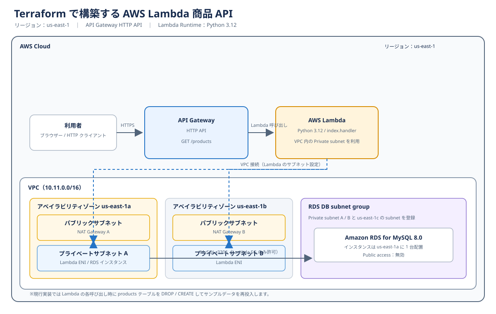

# Terraform で構築する AWS Web 環境（SSM 構成）

Terraform を使って、ALB・EC2・RDS からなる Web 環境を AWS 上に構築する学習プロジェクトです。先行する SSH 構成のプロジェクトを発展させ、EC2 の管理方法を踏み台サーバー経由の SSH から AWS Systems Manager（SSM）Session Manager に移行しました。SSH ポートを開放せずに EC2 を管理する構成を実装しています。

## 目次

- [背景と目的](#背景と目的)
- [研究の流れ](#研究の流れ)
- [主要技術](#主要技術)
- [システム構成](#システム構成)
- [設計上のポイント](#設計上のポイント)
- [主な出力](#主な出力)
- [必要環境](#必要環境)
- [セットアップ](#セットアップ)
- [SSM Session Manager での接続](#ssm-session-manager-での接続)
- [アプリケーションとデータベース](#アプリケーションとデータベース)
- [セキュリティとコストに関する注意](#セキュリティとコストに関する注意)
- [ディレクトリ構成](#ディレクトリ構成)
- [今後の予定](#今後の予定)

## 背景と目的

授業で手動構築した AWS の Web 環境を Terraform でコード化する取り組みの第 2 段階です。SSH と踏み台サーバーを使う構成から始め、今回は管理方式を SSM Session Manager に移行しました。さらに次の段階では AWS Lambda を導入し、Web アプリケーションの実行方式をサーバーレスへ発展させます。

このプロジェクトでは、EC2 を Private subnet に配置し、IAM Instance Profile と SSM Agent を使って管理します。管理用の SSH ポートや踏み台サーバーを設けずに接続できる構成を目指しています。

## 研究の流れ

1. **SSH 構成** — [SSH プロジェクト](../ssh/README.md)で、踏み台サーバー経由で EC2 を管理する構成を Terraform で作成します。
2. **SSM 構成（本プロジェクト）** — 踏み台サーバーと SSH による管理から、Session Manager を使う方式へ移行します。
3. **Lambda 構成** — [Lambda プロジェクト](../lambda/README.md)で、API Gateway と Lambda を使って商品データを扱う構成へ発展させ、EC2 上で PHP を実行する方式との違いを学びます。

この 3 段階を通して、インフラのコード化、サーバー管理方法、アプリケーション実行方式の違いを学びます。

## 主要技術

- **AWS** — VPC、Subnet、Internet Gateway、NAT Gateway、ALB、EC2、RDS for MySQL、Systems Manager
- **Terraform** — AWS リソースの定義・作成・削除
- **PHP / Apache** — EC2 上での Web サーバー実行環境
- **MySQL** — 商品データを保存するデータベース

## システム構成



※図は Terraform の現行設定を表しています。RDS は us-east-1c に 1 台作成し、DB subnet group には複数 AZ のサブネットを指定しています。

- リージョンは `us-east-1` です。Terraform の AWS provider で指定しています。
- VPC の CIDR は `10.11.0.0/16` です。Public subnet、Web サーバー用 Private subnet、RDS 用 subnet を作成します。
- Public subnet 上の ALB が HTTP（ポート 80）を受け付け、2 台の EC2 に振り分けます。
- Web Server A を元に AMI を作成し、Web Server B はその AMI から起動します。
- ALB のヘルスチェック先は `/hello.php` です。
- Web サーバーの Private subnet は、それぞれ NAT Gateway A / B 経由で外部へ接続します。
- RDS は `us-east-1c` に作成し、Public access を無効にしています。RDS 用 subnet はインターネット向けのルートを持ちません。

## 設計上のポイント

- **SSH と踏み台サーバーを使わない管理** — EC2 に `AmazonSSMManagedInstanceCore` ポリシーを付与した IAM Instance Profile を設定します。
- **通信元をセキュリティグループで制限** — Web サーバーへの HTTP は ALB からのみ許可し、RDS の MySQL（ポート 3306）は Web サーバーからのみ許可します。
- **Public / Private subnet の分離** — インターネットから直接アクセスする入口は ALB とし、Web サーバーと RDS は Private subnet に配置します。
- **Terraform による構成管理** — リソースをコードで定義し、`plan` で変更内容を確認してから適用できます。

## 主な出力

`terraform apply` 後に、次の値を確認できます。

- `alb_dns_name` — ALB の DNS 名。ブラウザーから Web 環境へアクセスするときに使用します。
- `rds_endpoint` — RDS の接続先エンドポイント。

```bash
terraform output
```

## 必要環境

- AWS アカウントと、Terraform が作成するリソースを操作できる IAM 権限
- [Terraform](https://developer.hashicorp.com/terraform/install)
- AWS CLI と設定済みの AWS 認証情報
- AWS CLI から SSM 接続する場合は Session Manager plugin

## セットアップ

1. Terraform のディレクトリへ移動します。

   ```bash
   cd terraform
   ```

2. `terraform.tfvars` を作成し、RDS のパスワードを設定します。

   ```hcl
   db_password = "REPLACE_WITH_A_STRONG_DATABASE_PASSWORD"
   ```

   `terraform.tfvars` は Git 管理対象外です。実際のパスワードをソースコードや README に記載しないでください。

3. Terraform を初期化し、構成を検証します。

   ```bash
   terraform init
   terraform validate
   terraform plan
   ```

4. 内容を確認して AWS リソースを作成します。

   ```bash
   terraform apply
   ```

## SSM Session Manager での接続

AWS Console の Systems Manager で対象 EC2 が Managed node としてオンラインになっていることを確認し、EC2 の **Connect → Session Manager** から接続します。

AWS CLI を利用する場合は、対象インスタンスの ID を指定します。

```bash
aws ssm start-session --target <instance-id>
```

EC2 のセキュリティグループでは SSH（ポート 22）を許可していません。SSM Agent の通信には EC2 からのアウトバウンド接続が必要です。この構成では NAT Gateway 経由で外部へ接続します。

## アプリケーションとデータベース

- `app/` には商品一覧を表示する PHP ファイルと画像を配置しています。
- `app/db.php` は DB 接続情報を環境変数（`DB_HOST`、`DB_USER`、`DB_PASSWORD`、`DB_NAME`）から読み込みます。Web サーバーの PHP 実行環境に設定し、認証情報をソースコードへ書かないでください。
- `database/init.sql` には商品テーブルとサンプルデータを定義しています。
- 現在の Terraform の User Data が EC2 に配置するのは、疎通確認用の `/hello.php` です。`app/` の PHP ファイルや `database/init.sql` は EC2 / RDS へ自動で配置・適用されません。
- `database/init.sql` のデータベース名は `ie3a26_db` です。`class_no` を変更する場合は、SQL 内のデータベース名も RDS の `db_name` と一致させる必要があります。

## セキュリティとコストに関する注意

- ALB は現在 HTTP（ポート 80）で公開されており、HTTPS / TLS は設定していません。公開環境で利用する場合は HTTPS 化を検討してください。
- `db_password` の `sensitive = true` は Terraform の画面表示を抑制する設定であり、state から値を除去・暗号化するものではありません。Terraform state は機密情報として扱ってください。
- `terraform.tfvars`、Terraform state、AWS 認証情報、秘密情報を Git に追加しないでください。
- NAT Gateway、ALB、EC2、RDS などの AWS リソースは利用料金が発生します。検証後は不要なリソースを削除してください。

```bash
terraform destroy
```

削除対象を確認してから実行してください。

## ディレクトリ構成

```text
.
├── app/
│   ├── db.php
│   ├── index.php
│   └── images/
├── database/
│   └── init.sql
├── terraform/
│   ├── main.tf
│   ├── outputs.tf
│   └── variables.tf
└── README.md
```

## 今後の予定

ALB・Auto Scaling を組み合わせた高可用性のある構成へ段階的に拡張
S3 や Lambda と組み合わせた構成への発展
セキュリティとコストの両面から比較・検証